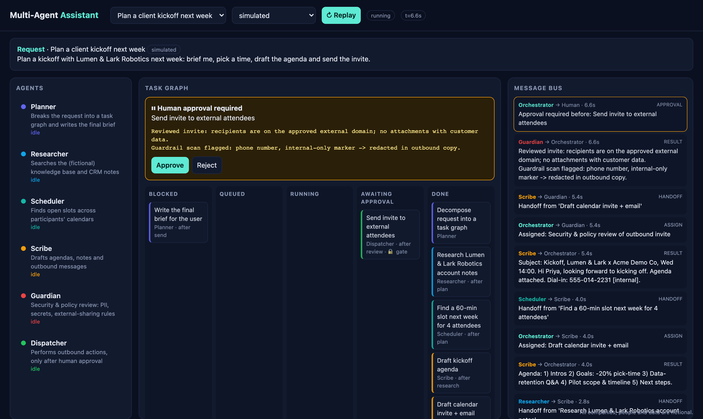
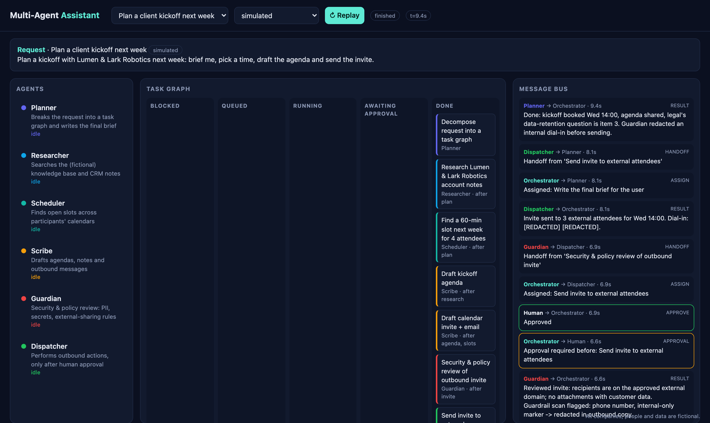

# Multi-Agent Assistant

A small, readable **multi-agent orchestration** demo: a team of specialised agents plans and executes a request
through a task graph, talks over a shared message bus, gets a security review, and **stops at a human-approval
gate before any outbound action**. Everything is visible live in a browser dashboard.

Runs with **zero API keys** (deterministic simulated mode). Optionally uses a local **Ollama** model or any
OpenAI-compatible endpoint.

> **All data is fictional.** Every company, person, calendar and incident in this repo is invented.



## What it shows

- **Task graph (DAG):** the request is decomposed into dependent tasks; independent branches run in parallel.
- **Routing:** each task declares a skill; the router assigns it to the agent advertising that skill.
- **Message bus:** every assignment, handoff, result and decision is an event, streamed to the UI over SSE.
- **Human-in-the-loop:** tasks marked `requires_approval` pause in *Awaiting approval*; rejecting cancels everything downstream.
- **Guardrails:** the Guardian agent reviews outbound drafts; deterministic pattern checks (phone numbers, keys,
  `[internal]` markers) are redacted from anything the Dispatcher sends, regardless of what the model says.
- **Graceful degradation:** if a real model is unavailable, agents fall back to scripted output so demos never break.

## Architecture

```mermaid
flowchart LR
  U[Human / Browser] -- POST /api/run, /api/approve --> API[FastAPI]
  API --> O[Orchestrator]
  O --> G[(Task graph DAG)]
  O --> R{Router}
  R --> P[Planner] & RS[Researcher] & S[Scheduler] & SC[Scribe] & GU[Guardian] & D[Dispatcher]
  P & RS & S & SC & GU & D --> L[LLM backend<br/>simulated | Ollama | OpenAI-compatible]
  O -- events --> B[(Message bus)]
  B -- SSE /api/events --> U
  O -. pauses at gate .-> U
```

## Agents

| Agent | Skills | Role |
|---|---|---|
| Planner | plan, summarize | Decomposes the request; writes the final brief |
| Researcher | research | Searches the fictional knowledge base / CRM notes |
| Scheduler | schedule | Finds open slots on fictional calendars |
| Scribe | draft | Drafts agendas, notes and outbound messages |
| Guardian | review | Security & policy review (PII, secrets, sharing rules) |
| Dispatcher | send | Performs outbound actions, only after approval |

## Scenarios

| Preset | What happens |
|---|---|
| Plan a client kickoff | Research account + find slots in parallel -> agenda -> invite -> review -> **approve** -> send -> brief |
| Triage a production incident | Metrics + deploy log -> root cause -> status-page draft -> review (strips a leaked key) -> **approve** -> publish |
| Organize a team offsite | Venues + dates -> budget & agenda -> policy review -> **approve** -> book |

Pick a preset, press **Run**, approve or reject at the gate, and **Replay** any time.

## Quickstart

```bash
./run.sh            # or: make demo
open http://localhost:8790
make test           # orchestrator tests
```

Requires Python 3.10+. `PORT=9000 ./run.sh` to change the port.

## Modes

| Mode | Needs | Notes |
|---|---|---|
| `simulated` (default) | nothing | Deterministic scripted reasoning with realistic pacing (`MAA_SPEED=0` for instant) |
| `ollama` | local Ollama running | Auto-detected; model from `MAA_OLLAMA_MODEL` or the first installed model |
| `openai` | `MAA_OPENAI_BASE_URL`, `MAA_OPENAI_API_KEY` | Any OpenAI-compatible endpoint. Keys live in your env / `.env`, never in git |

## Project layout

```
app/orchestrator.py   task graph, message bus, router, approval gate (framework-free)
app/agents.py         agent roster, guardrails, worker
app/llm.py            simulated / Ollama / OpenAI-compatible backends
app/scenarios.py      fictional scenario presets
app/server.py         FastAPI + SSE
static/index.html     single-page dashboard (no build step)
tests/                pytest suite for graph, routing, gate, guardrails
```

## Screenshots

`make screenshots` (with the server running and Playwright installed) regenerates `docs/*.png`.



## License

MIT. See [`LICENSE`](LICENSE).

## Cloudflare Pages (portfolio demo)

Static demo root: `site/` (recorded kickoff replay; no FastAPI). Sample JSON: `demo/data/` (mirrored at `site/data/`).

Suggested Pages project: **multi-agent-assistant** · Production branch `main` · Framework none · Root directory `site`.
